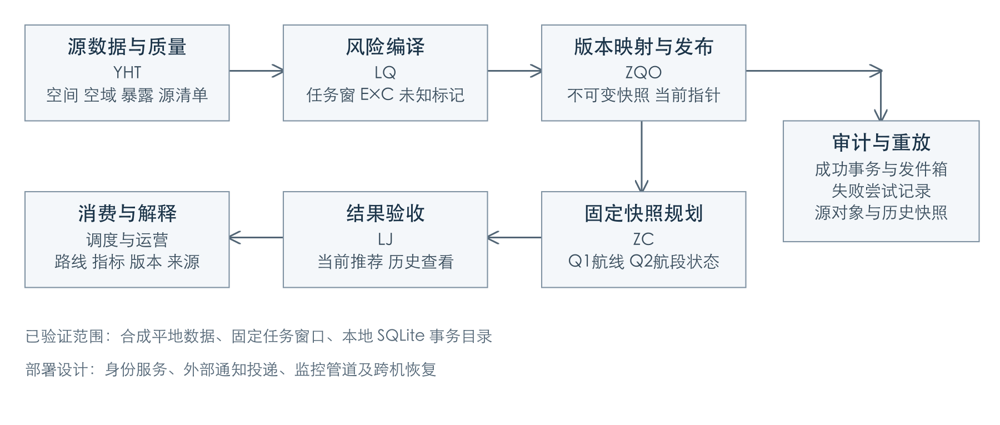
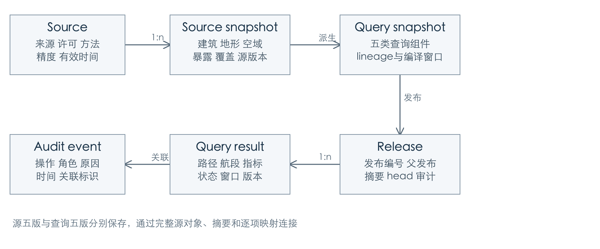

# SkyRoute 面向城市复杂三维环境的无人机物流配送航线规划与数据管理设计

SkyRoute Urban UAV Delivery Route Planning and Data Management in Complex 3D Environments

小组成员：ZQO、YHT、LQ、ZC、LJ

整合日期：2026年11月6日

代码与复核基线：`2850d89`，完整源码摘要见附录。

## 摘要

城市无人机配送同时受到建筑高度、动态空域限制和地面人员暴露的影响。航线是否可用，既取决于三维几何，也取决于输入的有效时间、数据质量及版本组合。SkyRoute 以模拟城市片区为对象，设计从空间数据接入、风险编译、不可变发布到航线查询与运行验收的完整数据管理方案。原型采用 SQLite 三维 R*Tree 筛选空间候选，以事务目录绑定场景、空域、风险数据、风险模型和规划配置，在内存中形成版本化计算图，并用 3D A* 与 Dijkstra 对照规划。风险采用明确的后果加权暴露代理，硬约束先于效率偏好，缺失信息保持未知或在发布前被拒绝。

五模块集成复核通过131项模块测试、7项原问题审查、11项整链路判据和25项风险专项检查。历史合成实验中，A* 在建筑场景与 Dijkstra 得到相同最优代价，扩展节点由699降至72；提高风险权重后，航程增加约14.2%，累计风险代理下降约86.7%。整链路验证进一步表明，限制更新、撤销和发布失败可以保持来源与版本可追溯。项目的主要成果是将查询可行性、风险解释和发布一致性连接起来，并明确每项结论对应的数据和实验条件。

关键词：三维空间数据；版本化图投影；动态空域；风险代理；事务发布

## 1 应用场景与问题定义

SkyRoute 面向城市配送任务的规划与数据管理。调度员输入起点、终点、出发时刻和任务窗口，系统提供满足已知约束的路线，并解释采用了哪些建筑、限制和风险数据。运营人员需要查看完整三维航段及其限制；空域与安全管理员维护限制和风险参数；系统管理员负责权限、质量、审计与恢复。地面居民和访客虽不直接操作系统，其暴露与潜在影响也是设计约束。

核心问题是：如何让一次三维航线查询使用时间适用、质量可判定、版本兼容的输入，并在数据变化后更新推荐，同时保留历史结果的解释依据？二维最短路径无法处理跨屋顶、不同高度的禁飞体及限高包络；单独增加路径算法也不能解决查询混读版本或缺失风险被默认成低风险的问题。

项目采用合理模拟的城市片区，以数据组织、查询、版本及治理设计为重点。原型使用平地、规则建筑或保守包围盒、固定机型、恒速和有限三维网格。飞控、真实动态自主避障及实际飞行部署属于研究范围之外。当前数据可公开复现，不包含个人轨迹或真实空域许可信息。

## 2 需求与数据分析

### 2.1 两项核心服务

Q1 为三维航线查询，输入位置、任务窗口与约束，输出路径、航程、时间、风险代理、五类版本及发布编号。状态区分 `feasible`、`infeasible` 和 `unknown`：有限图内无可行解属于无解，输入不完整、版本不符、超预算或当前算法无法判定的时间约束属于未知。Q2 提供航段约束、风险和来源解释，原型返回 `allowed`、`forbidden` 或 `unknown`，并支持旧路线逐段复核。区域级统一服务保留为后续扩展。

YHT 原型中的“Q1”是规划前的候选走廊检查，输出 `clear/blocked/unknown`；它不是全局航线求解。本报告将其称为“走廊预检”，将系统 Q1 专用于 ZC 航线规划，避免相同名称导致接口含义混淆。

非功能要求包括：一次查询固定完整输入；更新失败不产生成功发布；历史可重放；未知状态可解释；所有可行航段通过相同几何与硬约束检查。延迟、吞吐量和可用性目标需随部署条件设定，本轮重点验证这些正确性条件。

### 2.2 数据规模与生命周期

| 数据类别 | 合成基线 | 主要访问与更新 |
| --- | --- | --- |
| 建筑与地形 | 600×600米片区，最高160米；25栋建筑，31×31地形点 | 按三维范围读取；测绘修订产生新版本 |
| 动态空域 | 3个禁飞或限高体，带发布状态与有效区间 | 按任务窗口过滤；发布、修改、撤销均留历史 |
| 地面暴露 | 6个互不重叠的分区，含E、C、q和来源 | 按地面影响包络与时间窗读取；重新编译风险层 |
| 质量与元数据 | 36个覆盖瓦片、5类来源记录及发布清单 | 发布门禁、来源解释、完整性与摘要核对 |
| 查询与运行记录 | 任务、路径、指标、版本、审计事件 | 当前推荐检查、历史追溯和失败定位 |

源场景坐标为局部米制直角坐标，x向东、y向北、z向上，以共同参考平面z=0表示高程。内部采用显式声明坐标系的 JSON，不将局部米制坐标标为 GeoJSON；RFC 7946 的 GeoJSON 使用 WGS 84 经纬度。[1] 时间使用带时区字符串并转换为UTC，有效区间采用含起点、不含终点的半开区间。

数据接入先形成草稿，校验后封存为不可变源版本，再编译成可发布查询快照。当前发布及常用查询属于热数据；历史快照与审计属于温数据；导出归档属于冷数据。课程模拟保留策略为相关材料保存至验收后30日，中间草稿及无引用缓存7日清理，实际部署需依据许可与用途重定。YHT 原始规模估算中，2,400栋合成场景紧凑 JSON 约884 KB；增长评估应同时计入版本数量、索引、来源副本和审计，而不能只看单版地图大小。

## 3 系统架构与完整数据流

系统采用“源对象、派生风险与计算图、发布目录、查询服务”分层。源数据保留几何、质量和来源；风险编译把时段化暴露转换成固定任务窗的可计算输入；发布目录绑定完整版本组合；规划服务读取固定快照并返回可审计结果。LJ 的验收区分当前推荐和历史查看。



图1 总体架构与运行边界。实线主流程已在五模块合成链路中运行，生产身份、外部消息投递和跨机恢复属于部署设计。

一次正常任务按以下数据流执行：读取并核验 YHT 封存源，运行质量门禁与两个导出适配；LQ 根据任务窗口编译 E/C 时段；ZQO 保存源清单、转换参数、编译窗口和逐项版本映射，原子发布；ZC 固定快照生成航线并复核完整航段；返回前检查当前发布，LJ 验收结果身份、状态和指标。来源未知或不支持的地形在接入阶段被拒绝，原生未知风险则保留空间范围和原因。

关系型目录采用本地 SQLite 原型；源空间访问采用独立的 SQLite R*Tree 实验。五模块链路实际消费源 JSON 和导出结果，尚未把所有空间查询改为生产数据库请求。因此，空间索引基准与整链路验证分别提供证据，不将两者拼成未经测量的端到端延迟。

## 4 数据模型与访问设计

### 4.1 实体关系与模式



图2 源数据、发布快照与查询记录的逻辑关系。实际原型分别以结构化 JSON、空间库及发布目录表达这些实体。

源层的 `source` 描述许可、采集方法、有效时间和精度；`feature` 保存业务标识、类型、来源与质量，建筑、空域和地面分区提供各自几何属性。建筑保存闭合轮廓、底部和顶部高程；限制保存水平轮廓、上下界、限高、状态和有效期；暴露分区保存 E/C/q 与时段。覆盖瓦片标明资料完整性，缺失高度和风险不能通过删除对象变成无障碍或低风险。

发布层的 `components` 以组件类型和版本为唯一键，`releases` 保存完整快照与父发布，`head` 指向当前发布，`audit/outbox` 分别保存成功事件和待发送通知，`failed_attempts` 保存失败尝试。查询结果引用发布编号及五类版本，并保存窗口、路径、指标和原因。

两组版本具有不同职责。YHT 的源版本为 `scene/terrain/airspace/exposure/sources`；规划快照为 `scene/airspace/risk_data/risk_model/planner_config`。整链路的 `lineage` 保存完整源对象、源版本和清单、内容摘要、投影参数、风险窗口及逐项映射。它支持从返回路线追溯到原始暴露和限制，而不要求源版本字符串与派生版本相等。

### 4.2 索引 分区与缓存

空间访问先用三维包围盒索引取候选，再回表执行几何判定。SQLite R*Tree 的三维形式包含一个标识及三个维度的上下界，共7列；它保存范围索引，不能代替精确碰撞检查。[2] 建筑和空域使用三维候选过滤，地面暴露按航段的水平影响包络筛选。ZC 导出对复杂建筑采用保守包围盒，可能排除部分实际可行空间，换取当前内核下可复核的避障约束。

部署设计按不可变发布及空间瓦片组织数据，当前版本建立热索引，历史保留只读快照，归档进入对象存储。缓存键至少包含发布编号、任务窗口、起终点及规划配置；图缓存还包含网格域和风险编译条件。组件同版但发布编号变化时，旧结果仍需核对新鲜度。YHT 的单进程版本键 LRU 已验证换代失效，跨进程缓存通知属于后续部署工作。

典型操作包括：按窗口读取已发布且相交的限制；按影响包络取得风险时段；按发布编号取得不可变快照；按查询关联标识回查失败或恢复事件。索引降低候选数，发布清单决定版本组合，时间过滤决定记录适用性，三者分别承担职责。

## 5 技术选型与版本化图投影

| 候选 | 本项目中的价值 | 采用方式与代价 |
| --- | --- | --- |
| 内存全扫 | 逻辑直接，便于作为空间查询基准 | 保留为对照，访问量随对象数增长 |
| SQLite三维R*Tree | 标准库可复现，候选过滤与精算分离 | 原型采用；单文件写入与服务化能力受限 |
| PostgreSQL与PostGIS | 关系约束、事务与空间访问可集中管理 | 后续部署候选，尚无实库性能验证 |
| 持久化图数据库 | 邻接与属性访问直接，适合重复图分析 | 暂不部署；时间窗、模型、网格变化增加派生边维护 |
| 均匀三维网格索引 | 构建简单，适合内存局部处理 | 作为对照，跨格对象重复登记且参数敏感 |

深入研究的技术是版本化图投影。源数据库管理城市事实和时间语义，计算图以三维网格节点及允许航段为节点和边，保存非负目标代价。每张计算图绑定发布、网格范围、任务窗口和模型配置，可以由源快照重建。Neo4j GDS 的投影机制也将节点、关系和属性装入内存计算图，说明源存储与分析表示可以分离；本项目借鉴该组织思想，以 Python 按需邻接实现，并未部署 Neo4j。[3]

逐边远程查询空间库会产生大量往返，且需要协调多次读取的快照；预先持久化全部带权边则会把每次风险或窗口变化转化为大批派生更新。当前采用批量加载固定版本、内存按需构图：减少细粒度请求，但需要装载完整规划范围。只有重复查询收益超过构图、缓存和失效成本时，持久图投影才值得进一步评估。

该设计同时涉及数据血缘与可观测性。源版本和查询版本分别留存，失效定位根据旧、新几何及地面影响包络进行；风险下降、限制撤销也可能产生更优路线。若不能证明变化边集合完整，就重建计算图并重新搜索。图优化应同时衡量查询耗时、构图成本、失效开销和内存，而非仅比较 A* 的扩展节点数。

## 6 风险模型与三维航线方法

### 6.1 风险代理及硬约束

地面风险概念涉及飞行失效、偏离或坠落位置、人员暴露和条件后果。当前缺少机型失效率、落点核和伤害校准数据，因此使用后果加权暴露代理：区域 q=E×C，E 与 C 均为0到1的无量纲合成量。完整航段的地面影响包络采用水平投影外扩5米，按任务窗取相交区域的最大已知 q，并检查每个区域的时间覆盖。

定义航段三维长度为 ℓ，固定尺度 L₀=100米。航段代理 r=(ℓ/L₀)q_max，路线代理 R=Σr；目标代价 J=Σ[ℓ/L₀+λr]，λ≥0。R 可以大于1，表示累计暴露代理，不是事故或伤亡概率。固定速度下时间与距离成正比，报告飞行时间但不重复加权；能耗需增加机型和动力学模型后再纳入。

建筑、有效禁飞、限高包络以及 q≥0.9 的演示硬阈值先过滤航段，可接受范围内再比较目标代价。λ=0 仍须遵守硬约束。风险时段缺口或未知值保持未知；YHT 当前导出能力对缺失 E/C/q 直接拒绝，并校验 q=E×C，避免旧派生值掩盖源数据缺失。各阈值和包络是模拟配置，改变参数生成新模型版本。

### 6.2 A* 对照与动态更新

规划采用有限三维网格，每个节点最多连接26个邻居。候选边执行完整线段与扩展障碍体的交集检查，覆盖端点、实体内部、切触和对角穿角。整窗保守策略将任务窗口内任何时刻生效的限制视为本次搜索约束，因此计算图在查询期间保持静态，也可能排除允许等待后通过的路线。

Dijkstra 提供非负权最短路对照，A* 使用到目标的欧氏距离除以 L₀ 作为启发式。[4][5] 因为 r≥0、λ≥0，边代价不小于其归一化长度，三角不等式保证启发式一致。目标出队后回溯并重新检查每条航段。在有限、已知允许图上，两种算法应得到相同最优目标代价；等代价路径及未被优化的风险指标可以不同。

更新后先用新发布复核旧路线，再运行全量 A*。D* Lite 通过复用历史搜索状态修复变化边，是未来增量候选。[6] 它需要稳定的节点标识、目标、代价语义及完整变化集合；坐标、网格或聚合方式变化时，重建更易验证。本项目尚未实现或测量 D* Lite，不将其论文性能作为系统结果。

## 7 发布一致性与运行治理

### 7.1 发布与读取交错

发布者提交候选快照和预期父发布，事务写入组件、发布记录、成功审计和待发送事件，最后切换当前指针。内容相同的组件可复用，同一版本号不能改写内容。事务提交前失败时，当前发布保持原值；回滚后用独立连接记录失败请求和原因。业务变更与发件箱同事务可避免数据已写而通知未记的双写问题，消息消费者仍需处理重复事件。[7]

查询固定发布 v1 后可在内存计算；返回时重新读取当前指针。如果已经切换至 v2，则 v1 结果标为 stale，用于历史查看，当前推荐需重验。撤销可使查询组件重新等于旧组合，但新发布编号、源撤销记录和来源清单仍保留区别。数据库读快照与业务版本兼容是不同问题；部署时可在只读可重复读事务中装载对象，再由发布清单约束业务组合。[8]

发布失败记录属于当前原型实际运行的恢复路径。若进程恰在回滚与独立记账之间终止，仍需外部持久日志补足；外部通知投递、跨机恢复和引用清理尚属部署设计。运行验收检查完整版本、发布身份、原因、有限非负指标及预算，不把字段缺失或 NaN 当作有效结果。

### 7.2 权限 隐私与伦理

设计采用职责分离：调度员提交任务；数据维护员编辑草稿；独立安全评审员审核阈值与发布；规划服务只读已发布切片；审计员受控读取事件；运维人员执行有记录的恢复。身份来自认证会话，不能信任请求体自报角色。角色策略已有模拟测试，真实 API 鉴权、数据库授权及敏感字段导出仍需部署验收。

数据库可通过权限及行级策略实施第二层限制。PostgreSQL 行级安全的拥有者和特权角色存在绕过条件，因此应用角色应与拥有者分离，并用真实连接角色验证策略。[9] 传输与备份加密、凭据独立管理、成功及拒绝事件留痕构成部署方案，不能以版本哈希代替发布者身份认证。

本项目只使用区域级合成数据。真实接入应核对许可、用途、精度和保留期，尽量使用授权聚合信息；Q2 对外提供必要来源与质量解释，限制细粒度时序暴露导出。区域聚合仍可能揭示小群体活动，风险优化也可能把飞行负担从商业区转移到住宅区。后续评估应按区域比较经过次数与累计代理，并检验输入误差，避免只报告全城平均值。

## 8 评估结果与证据范围

### 8.1 最新集成复核

2026年11月6日在主线 `2850d89` 上独立运行五模块回归与集成脚本，原始输入输出、命令、环境和源码摘要保存在 `docs/final/evidence/`。各检查组分别报告，避免将模块单测和整链路判据混作一种统计。

| 检查组 | 通过数量 | 检验重点 |
| --- | --- | --- |
| 模块回归 | 131/131 | YHT42、LQ19、ZC24、ZQO31、LJ15 |
| 原问题审查 | 7/7 | 未知风险、地形覆盖、缓冲、版本、stale、数值与Q2追溯 |
| 五模块整链路 | 11/11 | 来源映射、发布更新与撤销、失败审计、历史重开 |
| 风险专项 | 25/25 | 独立导出入口、E/C缺失、硬软约束、时间窗及来源 |

修复过程也提供设计证据：整链路有质量门禁，并不保证独立导出入口同样安全。LQ 后续发现单独缺 E/C、保留旧 q 的绕过情境，YHT 增加各入口的源值校验后才通过复核。由此将质量检查设在数据边界，发布层再核对完整性，而不是只依赖最外层调用方。

### 8.2 空间访问与算法实验

以下为2026年11月5日保存的历史实验，不是本轮重新计时。YHT 空间实验在 Windows 11、Python 3.12.14、SQLite 3.53.1 单进程内存库中进行，每种方法预热后重复5轮，含120条走廊和80条航段查询。源完整性在装载时校验，查询计时排除重复计算源摘要，包含候选过滤和 Python 几何复核。[10]

| 建筑数 | 全扫Q2中位数 μs | 三维索引Q2中位数 μs | 全扫与索引平均候选数 |
| --- | --- | --- | --- |
| 200 | 984.90 | 76.65 | 200 / 0.9 |
| 800 | 3680.35 | 76.85 | 800 / 3.1 |
| 2400 | 10389.85 | 79.35 | 2400 / 13.9 |

数据支持在该合成分布下以包围盒过滤减少几何检查。二维加高度过滤和三维索引在当前建筑高度分布中候选数接近，不能据此声称三维索引在所有城市环境都更快。短基准的尾延迟受运行环境影响，以上结果不代表数据库服务端吞吐或生产 SLA。

ZC 算法实验在 Darwin arm64、Python 3.15.0 内存原型中执行，固定847个候选节点、10米网格，每个情境和算法记录7次。12个情境中状态一致，可行结果的最优目标代价差小于1e-9。无热点建筑场景，两者均得到116.5685米路线；Dijkstra/A* 扩展699/72个节点，中位耗时31.553/3.425毫秒。横贯全高度的禁飞墙场景两者均扩展364个节点，A* 没有表现出耗时优势。[11]

| 同一热点场景的A*权重 | 航程 m | 时间 s | 累计风险代理R |
| --- | --- | --- | --- |
| λ=0 | 116.5685 | 11.6569 | 0.502132 |
| λ=2 | 133.1371 | 13.3137 | 0.066569 |
| λ=8 | 133.1371 | 13.3137 | 0.066569 |

提高权重使路线绕开热点，航程增加约14.2%，代理下降约86.7%。这体现合成模型中的偏好取舍，不表示真实事故率下降。不同权重下目标 J 的定义不同，跨权重应比较航程和 R，而不能直接比较 J。LQ 独立编译的同场景结果保留相同趋势。[12]

### 8.3 完整链路更新实例

整链路使用 YHT 600米源片区中的裁剪规划域，20米网格、5米障碍缓冲及距离目标 λ=0。正常发布1的路线长612.5483米、耗时指标61.2548秒、风险代理4.212039。新禁飞体使旧路线5个航段禁止；发布2生成不同三维路径，长度仍为612.5483米，代理变为4.452608。该场景存在等长绕行，因此不能将“路线变化”写成“距离增加”。撤销后的发布3恢复原路线与代理，同时保留源空域的撤销历史。[13]

模拟提交前失败时，当前指针、成功审计、通知和发布数量保持不变，失败尝试另行落库。重新打开目录后，三个发布的完整快照和来源一致。旧发布即使与当前组件版本相同，也不能作为当前推荐验收通过；明确选择历史查看时可重放。错误风险窗口返回 unknown，并保留所选发布的五类版本和原编译窗。

## 9 设计权衡与后续验证

| 权衡 | 当前选择及代价 | 后续验证 |
| --- | --- | --- |
| 空间精度与计算量 | 有限规则网格及保守包围盒，便于复核但可能排除细窄通道 | 同物理场景比较5/10/20米网格及复杂几何 |
| 整窗约束与时间可行性 | 窗内限制全程适用，保持静态图但减少等待机会 | 时间扩展图，对比可行率、状态数与延迟 |
| 一致性与新鲜度 | 固定不可变快照，返回前检查当前发布 | 查询与连续更新交错，记录新结果可见延迟 |
| 可解释风险与模型真实性 | E×C及固定包络易审计，缺少概率校准 | 机型、风、落点及区域误差敏感性分析 |
| 重规划成本与实现复杂度 | 小场景全量A*，简化变化处理 | 稳定拓扑下比较变化定位加D* Lite修复总时间 |
| 历史追溯与存储成本 | 完整来源随快照保存，重放直接但会重复占用空间 | 按引用归档、内容去重及恢复一致性验证 |

在相同版本和参数下比较候选方案，是解释实验的前提。性能评价需拆分源加载、风险编译、构图、搜索、复核及发布成本；部署时再测并发、网络、落盘和失败恢复。真实地面风险与公平性评价需要授权数据和校准模型，当前代理用于机制研究。

本项目形成了可运行的分层方案：数据质量决定可判定性，发布清单决定输入一致性，图搜索在已知允许空间比较偏好，来源映射支持结果解释和更新追溯。上述连接使系统能够在约束变化和失败情境下维持明确的状态，而不把更短路径直接等同于更安全配送。

## 10 成员贡献与AI使用说明

| 成员 | 实际成果范围 | 展示页 |
| --- | --- | --- |
| ZQO | 空域生命周期、事务发布、版本与来源映射、总体架构及五模块链路 | 1–2 |
| YHT | 场景需求、数据模型、空间索引、质量门禁与导出修复 | 3–4 |
| LQ | 风险模型、治理规则、时间窗编译及独立风险接口复核 | 5–6 |
| ZC | 三维规划、对照评估、输入校验、跨模块复核与最终材料整合 | 7–8 |
| LJ | 运行验收、当前与历史语义、异常指标检查和恢复方案 | 9–10 |

项目使用 AI 辅助资料检索、方案比较、文档与代码编写、测试和材料整合。技术结论通过官方资料、可运行测试和原始输出核对；模拟假设及尚未执行的部署检查分别记录。各成员对本人负责内容承担审核责任，最终人工确认及实际贡献比例按课程表格填写。贡献比例、学号与签字由成员本人确认，不由任务分工自动推定。

## 参考文献

[1] H. Butler et al. The GeoJSON Format. RFC 7946, 2016. https://www.rfc-editor.org/rfc/rfc7946 。坐标语义。

[2] SQLite. The R*Tree Module. https://www.sqlite.org/rtree.html 。三维范围索引与候选过滤。

[3] Neo4j. Native projection, Graph Data Science Manual. https://neo4j.com/docs/graph-data-science/current/management-ops/graph-creation/graph-project/ 。内存图投影机制。

[4] E. W. Dijkstra. A note on two problems in connexion with graphs. Numerische Mathematik, 1:269–271, 1959. https://doi.org/10.1007/BF01386390 。非负权最短路径。

[5] P. E. Hart, N. J. Nilsson, B. Raphael. A Formal Basis for the Heuristic Determination of Minimum Cost Paths. IEEE Transactions on Systems Science and Cybernetics, 4(2):100–107, 1968. https://doi.org/10.1109/TSSC.1968.300136 。A*基础。

[6] S. Koenig, M. Likhachev. D* Lite. AAAI, pp.476–483, 2002. https://idm-lab.org/bib/abstracts/papers/aaai02b.pdf 。增量搜索候选。

[7] AWS. Transactional outbox pattern. https://docs.aws.amazon.com/prescriptive-guidance/latest/cloud-design-patterns/transactional-outbox.html 。事务发件箱。

[8] PostgreSQL. Transaction Isolation, PostgreSQL 18 Documentation. https://www.postgresql.org/docs/18/transaction-iso.html 。数据库快照设计。

[9] PostgreSQL. Row Security Policies, PostgreSQL 18 Documentation. https://www.postgresql.org/docs/18/ddl-rowsecurity.html 。角色与行级权限边界。

[10] SkyRoute YHT. 空间访问原始基准，2026-11-05。仓库 `docs/modules/yht/results/benchmark.json`。

[11] SkyRoute ZC. 12情境算法对照，2026-11-05。仓库 `docs/modules/zc/results/benchmark.json`。

[12] SkyRoute LQ. 风险编译及权重对照，2026-11-05。仓库 `docs/modules/lq/results/evaluation.json`。

[13] SkyRoute 小组. 主线2850d89集成复核，2026-11-06。仓库 `docs/final/evidence/verification.json`、`five-module.json`、`risk-review.json`、`audit.json`。

外部在线技术资料本次核对日期为2026年11月6日；论文出处沿用各模块参考文献。内部实验均为本项目合成数据，外部资料不作为本项目性能证据。

## 附录 复现与证据定位

在仓库根目录执行各模块 README 中的 unittest 命令，并运行：

```bash
python3 -B docs/integration/audit.py
python3 -B docs/integration/five_module.py --output /tmp/skyroute-five-module.json
python3 -B docs/modules/lq/prototype/review_integration.py --output /tmp/skyroute-risk-review.json
```

`evidence/verification.json` 保存五模块完整日志、命令、运行环境和源码摘要；另外三个 JSON 保存审查及整链路输入输出。历史基准文件保留原始时间戳与参数；本轮只重跑正确性和集成检查，不重写历史性能样本。课程覆盖、交付清单、展示讲稿和贡献材料准备见本目录其他 Markdown 文件。
