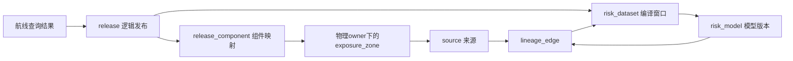

# 第7章 数据治理、安全、隐私与伦理

## 7.1 质量与版本化派生数据

无人机运营人员需要知道风险值依据哪些输入、是否覆盖任务时段，以及模型更新后旧结果能否重现。治理以统一数据库为准：`exposure_zone`保存来源与E/C/q，`risk_model`标识不可变模型，`risk_dataset`绑定逻辑发布、物理暴露组件、编译窗口和编译器。风险公式移入附录，正文把风险层作为可重建、带版本的派生数据集。[1], [5]

沿用已有NOT NULL、数值范围和q=E×C的CHECK；新增模型有效期门禁、`risk_input_period`、`derived_risk`与`quality_check`。时段先裁剪至任务窗，数据库拒绝重叠；封存时独立核对所有分区覆盖时长和最大代理值。即使应用写入“质检通过”，时间缺口仍无法封存。合法数据生成后禁止改写，失败保留草稿或回滚，并记录可复核原因。已批准或被引用的模型禁止原地改参，修订使用新模型ID；启停状态另存`risk_model_control`并审计，历史解释不随停用改变。[1]

## 7.2 血缘与操作C

操作C把结果的release_id连接组件、物理owner、分区、派生层和来源清单，返回模型版本及上游暴露版本。共享组件的物理owner可以是旧发布，不能直接按新逻辑编号筛原表。实验中R1复用R0暴露组件，两个航段均正确追溯到R0、SRC-SYN和模型1.0.0；EXPLAIN QUERY PLAN记录主键及组件索引访问。查询结果表由ZC下一棒实现，本轮明确使用临时夹具，SQL及字段合同已交接。[1]

`lineage_edge`记录源、模型、组件到派生层的依赖，触发器校验端点和实际依赖。源更新时，递归反查定位需要重算的D0/D1；这表示候选失效范围，不直接判定航线禁飞。模型变更或时段变化要重新编译，旧发布保留只读。[1]

## 7.3 权限、审批与审计

| 用户 | 读表/视图 | 写入 | 发布 | 审批 |
| --- | --- | --- | --- | --- |
| 调度员 | `v_exposure_summary`本机构摘要 | 后续ZC任务入口 | 禁止 | 禁止 |
| 运营人员 | `v_exposure_summary`及任务解释 | 禁止修改源表 | 禁止 | 禁止 |
| 空域及安全管理员 | `v_exposure_detail`、模型和来源 | 受控草稿/质检入口 | 经独立审批后发布 | 仅可审批他人请求 |
| 系统管理员 | 运行元数据与受控审计 | 身份/策略维护 | 默认业务入口不授予 | 禁止业务自审 |

读取示例在服务持有的连接上注册身份函数，以受限视图按机构、活跃状态、策略及敏感等级过滤。固定查询端点配合SQLite authorizer拒绝绕过视图、CTE伪装和写操作。SQLite文件所有者仍是可信管理边界；生产候选PostgreSQL可用GRANT与RLS加强隔离，应用角色不拥有表且无BYPASSRLS。[2], [3]

`governance_request`绑定作者、候选发布与内容摘要，`governance_approval`通过触发器拒绝作者自审及非活跃安全角色。发布网关复算摘要，防止审批后换内容，再调用ZQO事务接口。原始发布函数属于可信服务内部，外部应用不得直接获得写连接。审计保存身份、动作、对象/发布、结果、请求和原因；读取事件另存角色快照，不保存完整敏感轨迹。成功审批、查询、拒绝及模型启停可追查。内部保留建议为90日热存、365日归档；被历史结果引用的模型、血缘和发布至少与该结果共同保留。归档删除与恢复验证交LJ实施，当前触发器不会自动清理。[4]

## 7.4 共享价值、隐私与伦理

规划内部仍使用精确分区，面向调度的展示只保留200米格网、分区数和粗粒度代理，少于两个合格分区的格子不显示。它降低细节泄露，也会隐藏局部差异、减少可显示区域，不能替代规划输入或作为匿名保证。粒度是演示参数；真实接入需按许可、目的和风险评审确定，并记录地域与保留要求。[1]

人口密度不能直接等同于安全性；绕开热点可能将负担转移到住宅区，评估应按区域统计经过次数和代理累计量。AI可辅助发现异常E/C/q和敏感字段，但缺失、偏差及新格式会造成误报漏报。已实测的是确定性约束；AI建议只产生待复核标记，人工确认后才能形成新数据或策略版本。[4], [5]

## 附录：模型及证据范围

演示代理q=E×C，航段累计r=长度/100米×区域最大q，硬阈值0.9，均为合成参数。数据库实验使用6区、2发布、2完整派生层及1条临时查询；具体测试数、环境、SQL、结果、计划和源码摘要见`experiments/results/governance.json`。没有实测PostgreSQL权限或AI异常检测准确率。课程依据：PDF第2页质量/血缘/权限，第4页新兴治理技术，第5页安全隐私伦理，第6页权衡与评价。[5]
