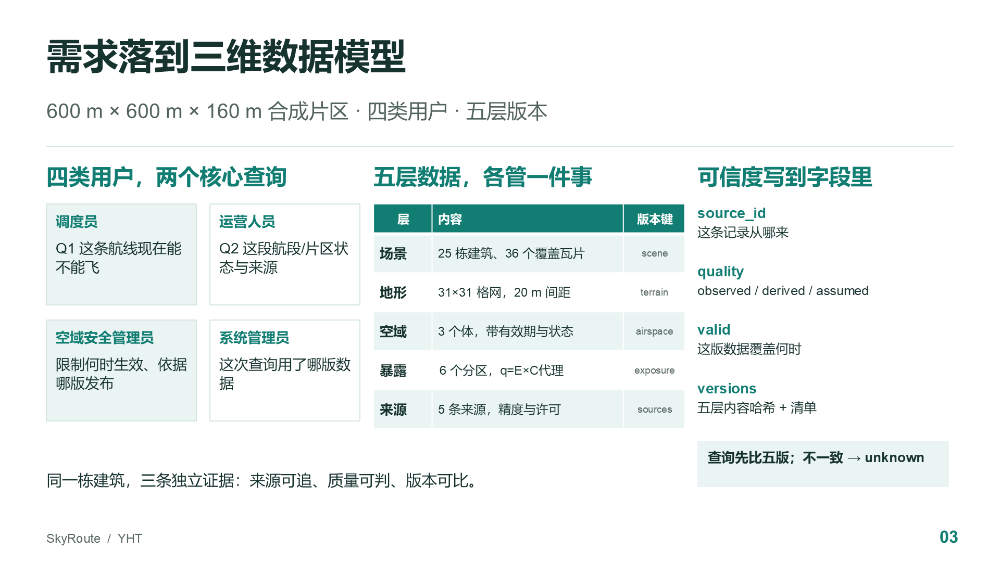
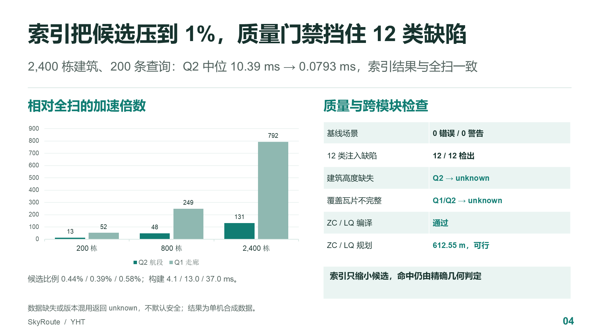

# 两页 PPT 讲稿与来源

对应汇报第 3–4 页。每页约 2 分钟；先讲"为什么这样建模"，再讲"实测换来了什么"。

## 第 3 页：需求落到三维数据模型

**主信息**

SkyRoute 的查询需求可以落成五层可独立寻址、独立版本化的三维数据；模型不只描述"对象是什么"，还描述"这条记录可不可信"。

**要点**

- 四类用户对应两类查询：调度员要 Q1 的航线可行性；运营要 Q2 的航段/区域状态；空域管理员关心限制有效期与发布依据；系统管理员关心这次查询用了哪版数据。
- 五层：场景（25 栋建筑、36 个覆盖瓦片）、地形（31×31 格网、20 m 间距）、空域（3 个体，带有效期）、暴露（6 个分区，q=E×C 为代理值）、来源（5 条，带精度与许可）。
- 可信度不靠一个"质量好"的标签，而是四个字段：`source_id` 追来源，`quality` 区分 observed/derived/assumed，`valid` 限定覆盖时间，`versions` 给出五层内容哈希与清单。
- 查询前先比五版；不一致、越界、覆盖不完整或高度缺失返回 `unknown`，不把"不知道"写成"安全"。

**讲述建议**

从"同一栋楼，三个问题"开场：它在哪、它多高、这版数据能不能用于 8:05 的查询。前两个是几何/属性，第三个是治理字段。强调 600×600×160 m 是研究范围，不是真实城市；25 栋是合成样例，规模实验另做。

讲到五层时，不要逐行念表；指出"建筑和地形分开、空域和暴露分开"是为了让更新时间不同的数据各自换版，避免整包重发。

**来源**

- 场景与字段：`prototype/yht_model.py`；`results/scene-stats.json`。
- 设计与决策：`design.md` 第 2–6 节、YHT-D1..D11。
- 质量规则：`prototype/quality.py`；`results/quality.json`。
- 口径：`docs/scenario-contract.md`。

**预览**

## 第 4 页：索引、质量与跨模块验证

**主信息**

三维索引把候选压到 1% 以下，但只负责"缩小范围"；是否命中仍由精确几何判定。数据缺失或版本混用必须返回 unknown，这条语义在跨模块导出时同样成立。

**要点**

- 200/800/2,400 栋三个规模、120 条 Q1 + 80 条 Q2：索引与全扫的状态和命中集合完全一致，签名不一致为 0。
- 2,400 栋时 Q2 中位 10.39 ms → 0.0793 ms（约 131×），Q1 122.94 ms → 0.155 ms（约 792×）；候选比例 0.44% / 0.39% / 0.58%。
- 代价：三维索引构建 4.1 / 13.0 / 37.0 ms，2,400 栋库文件 1.07 MB；查询计时含预检和 Python 精确复核，不含落盘。
- 缓存与并发小实验：20 条查询冷 602.1 µs、热 17.5 µs；SQLite WAL 下读事务不被写事务阻塞。两者都是单机机制验证，不是生产 QPS。
- 质量门禁：基线 0 错误 0 警告；12 类注入缺陷全部检出；建筑高度缺失、覆盖瓦片不完整、版本不一致都返回 unknown。
- 跨模块：导出快照通过 ZC `preflight`，A\* 得到 612.55 m、61.25 s 的可行航线；同一快照下直线航段被 B-001 阻断，与绕行结果不矛盾。6 个暴露分区转成 LQ profile 后，LQ `compile_profiles` 仍得到同一条航线、risk_proxy 4.2120；q 最大 0.82，未触发 0.9 硬阈值。

**讲述建议**

先给结论："索引不是让答案变准，而是让候选变少。" 再解释为什么 2D 与 3D 在本场景差距不大：查询高度落在建筑高度范围内；但换成高空航线或限高体，二维索引会漏判。不要把 131×/792× 说成生产 QPS，它是单机、内存库、200 条合成查询的中位数。

最后用 ZC/LQ 导出收尾：这份数据不是只在自己模块里自洽，ZC 的 preflight、规划器和 LQ 的 `compile_profiles` 都能直接消费；但 L 形建筑取包围盒、地形仍为平地、E/C 是合成假设，是三个明确的限制。

**来源**

- 基准：`results/benchmark.json`、`results/summary.csv`；复现 `prototype/evaluate.py`。
- 测试：`prototype/test_yht.py`（37 项）。
- 质量：`results/quality.json`。
- 导出：`results/zc-export.json`、`results/zc-export-summary.json`、`results/lq-export.json`、`results/lq-export-summary.json`。
- 存储选型：`storage.md` 第 3–7 节；评估条件见 `evaluation.md` 第 1 节。

**预览**

## 口播边界

- 所有数字来自 2026-11-05 本机单进程合成场景；不同机器的绝对耗时会变，候选比例与正确性签名应保持一致。
- `q=E×C` 是土地利用代理，不是人口、不是事故概率；E/C 的具体含义与聚合由 LQ 负责，本页只讲暴露输入和字段对齐。
- 索引结论不覆盖 PostGIS 实库、生产级并发、跨进程缓存和真实数据；这些列在 `evaluation.md` 的"未执行评估"。
