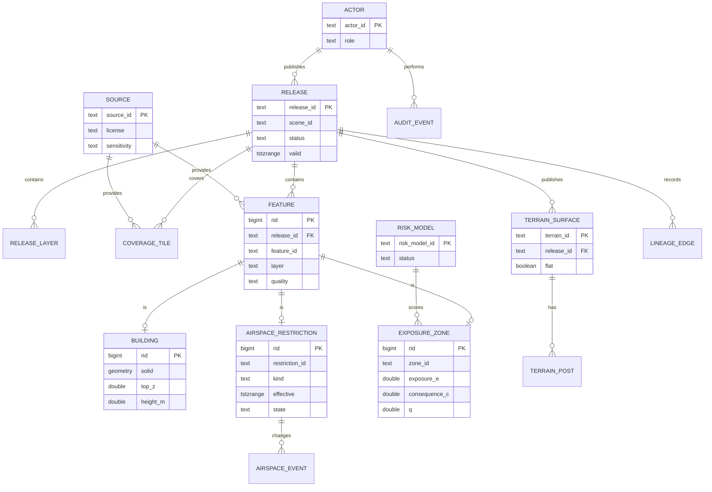

# SkyRoute 报告章节草稿：需求、数据模型与数据库设计（v2）

> **2026-11-07 数据更新（AI 按 ZC 指示完成，不计入 ZC 工作量）**：YHT 的操作 A 实验已改用香港九龙开放数据重跑（[香港数据快照](../../../v2/data/hk/README.md)），最新数值以 `experiments/results/` 与最终报告为准；本文与 `slides.md` 中的数值来自原合成数据，保留为过程记录。

状态：v2 章节初稿，供整合与交叉审阅。日期 2026-11-06，负责人 YHT。完整字段见 [数据字典](data-dictionary.md)；本文给出报告第 2、4 章的叙述、ER 图、关系模式与典型查询。

## 2 需求与数据分析

SkyRoute 管理城市三维环境、动态空域和地面暴露与风险三类数据，使每次航线查询都基于一致、可追溯的数据快照。平台不把航线算法当作主线：Q1 三维航线查询和 Q2 航段/区域状态与来源查询是下游服务，数据接入、版本、质量、血缘与权限才是本章要解决的问题 [11, pp. 2, 4–7]。

### 2.1 场景与用户

合成片区为 600 m × 600 m × 160 m 的局部直角坐标场景，包含 25 栋建筑（含一栋 L 形建筑）、31×31 地形点、3 个空域限制体和 6 个地面暴露分区。局部米制坐标避免投影变形，适合课程规模的几何验证；真实接入时再记录坐标转换和高程基准。

| 用户 | 主要问题 | 对平台的要求 |
| --- | --- | --- |
| 物流调度员 | 这条三维航线现在能不能飞 | 低延迟 Q1；返回可行性、原因和所用版本 |
| 无人机运营人员 | 这段航段/片区为什么被限制，数据从哪来 | Q2 返回限制、来源、有效期和审计线索 |
| 空域及安全管理员 | 限制何时生效、何时撤销、谁发布的 | 发布/撤销事务、有效期和发布审计 |
| 系统管理人员 | 这次查询用了哪版数据，能否复现 | 版本清单、覆盖检查、访问与操作审计 |

设计含义：读路径必须绑定 `release_id`，不能边查边取“最新值”；写路径独立发布，发布后不可原地修改。这样 Q1/Q2 的结果才能复现，空域更新也不会与查询交错。

### 2.2 功能需求

| 编号 | 需求 | 输入 | 输出/验收 |
| --- | --- | --- | --- |
| F1 | Q1 三维航线查询 | 起终点、出发时间、规划窗、约束、版本 | 航线或不可行/未知、原因、距离时间、风险分量、五层版本 |
| F2 | Q2 航段/区域状态与来源 | 三维航段或区域、时刻/窗口、版本 | 允许/禁止/未知、限制及有效期、风险、来源与审计 |
| F3 | 空域维护 | 限制体、生效窗口、发布/撤销动作 | 新发布或撤销事件；旧发布只读保留 |
| F4 | 数据发布 | 建筑、地形、空域、暴露输入 | 质量门禁通过后的不可变发布与覆盖清单 |
| F5 | 查询审计 | 查询参数、版本、结果状态 | 可追溯的请求记录；不存完整敏感轨迹 |
| F6 | 权限控制 | 角色、资源、敏感级别 | 最小权限读取/发布/导出；拒绝有原因 |

F1/F2 的状态优先级为：硬约束命中返回 `infeasible`/`forbidden`；缺失关键数据或版本不一致返回 `unknown`；两者都不成立才返回可行/允许。超时不记为无解。

### 2.3 非功能需求

| 维度 | 目标 | 说明 |
| --- | --- | --- |
| 延迟 | Q2 在 2,400 栋、单机合成数据下 p95 不超过 200 ms；Q1 的几何候选查询不超过 50 ms | 设计目标，不是端到端承诺；v1 已测得索引候选约 0.08–0.16 ms，不含服务与网络 |
| 新鲜度 | 空域事件分钟级可见；建筑季度、地形年度、暴露月度 | 发布延迟与源数据延迟分开记录 |
| 可用性 | 读路径 99.5%，发布失败可回滚 | 单机原型不验证高可用，部署方案由 LJ 负责 |
| 一致性 | 每次查询绑定一个发布；五层版本 + 风险模型版本一致 | 不跨发布拼接对象 |
| 可追溯 | 任意结果可回到对象、来源、发布和审计事件 | 对象级 `source_id` + 发布清单 + `audit_event` |
| 合规 | 分级访问、最小化、保留期可配置 | 具体策略由 LQ 的治理章节细化 |

### 2.4 三类数据

| 数据 | 来源与格式 | 更新频率 | 基线规模 | 三年假设 | 主要质量风险 |
| --- | --- | --- | --- | --- | --- |
| 城市三维环境 | 城市 GIS/BIM/LiDAR；GeoJSON/GPKG/IFC/LAS | 建筑季度或年度；地形年度 | 25 栋、961 个地形点、36 个覆盖瓦片 | 10 个片区约 2,400 栋、9,610 个地形点 | 高度缺失、轮廓自交、坐标/高程基准不一致、版本过期 |
| 动态空域 | 空域机构接口或人工发布；JSON/CSV | 事件驱动，分钟级 | 3 个限制体 | 约 100 条活动限制、每日 20 条事件 | 生效时间歧义、重复 ID、撤销后复用、发布与查询交错 |
| 地面暴露与风险 | 人口/POI/土地利用；CSV/GeoJSON；LQ 派生 | 月或季度；模型评审时 | 6 个分区、1 个风险模型 | 60 个分区、每月 1 版 | E/C 假设不透明、分区重叠或漏覆盖、代理指标被误读为概率 |

规模估算按对象数和发布次数做算术，不是实测：2,400 栋时单版发布 JSON 约 884 KB；每日 1 版、保留 3 年约 1,095 版，原始约 0.97 GB，加索引和历史约 2 GB。空域事件 3 年约 2.2 万条，审计按每日 1 万次查询约 11 GB，热库只留 90 天。详细假设见[数据字典第 8 节](data-dictionary.md#8-数据规模与三年增长假设)。

### 2.5 生命周期与访问模式

生命周期为“采集 → 暂存 → 质检 → 发布 → 查询 → 归档”。采集阶段登记来源、许可、精度和获取时间；暂存阶段允许 JSONB 灵活字段；质检阶段检查结构、几何、属性、时间、覆盖和版本；发布阶段生成五层版本、清单哈希和覆盖瓦片；查询阶段只读绑定发布；归档阶段保留只读发布和血缘，不保留可变中间状态。

| 访问模式 | 频率 | 路径 | 设计 |
| --- | --- | --- | --- |
| Q1 航线查询 | 高 | 按发布、时间窗、三维走廊取障碍与空域候选 | 三维 GiST + 精确几何；结果绑定版本 |
| Q2 航段/区域查询 | 高 | 按发布、时刻/窗口、三维航段取限制、风险、来源 | 空间 + 时间索引；返回对象级来源 |
| 发布/撤销 | 低 | 写新发布与事件 | 事务、幂等、失败回滚、审计 |
| 质检/批处理 | 中 | 全量/瓦片扫描 | 分区裁剪、并行瓦片、错误隔离 |
| 审计/复现 | 低 | 按请求、发布、时间检索 | 追加写、BRIN/月分区、冷热分层 |

### 2.6 利益相关者

| 利益相关者 | 关注点 | 平台响应 |
| --- | --- | --- |
| 调度员、运营人员 | 结果快、原因清楚、能复现 | Q1/Q2 延迟目标、显式 `unknown`、版本清单 |
| 空域及安全管理员 | 限制及时生效、撤销可审计 | 发布事务、有效期、事件序列、权限分离 |
| 系统管理人员 | 数据质量和版本一致 | 质量门禁、覆盖检查、发布清单、审计 |
| 数据提供方 | 来源可追踪、许可不被混用 | `source` 登记、对象级血缘、许可字段 |
| 审计/复核人员 | 能回答“为什么允许/拒绝” | 来源、版本、限制、审计事件 |
| 居民与访客 | 风险表达不被误读、隐私不被泄露 | 聚合暴露、非概率声明、分级访问 |

## 4 数据模型与数据库设计

### 4.1 ER 图



`FEATURE` 是建筑、空域限制和暴露分区的公共头，子类型共享 `rid`；`TERRAIN_SURFACE` 直接归属发布，不经过 `FEATURE`，因为地形是连续面而不是逐对象发布。`RELEASE_LAYER`、`COVERAGE_TILE` 和 `LINEAGE_EDGE` 是发布、覆盖与血缘的辅助实体。

### 4.2 关系模式

| 表 | 主键 | 外键 | 关键约束 |
| --- | --- | --- | --- |
| `release` | `release_id` | `base_release_id → release` | 发布后只读；`lower(valid) < upper(valid)` |
| `release_layer` | `(release_id, layer)` | `release_id → release` | 五层齐全；哈希与内容一致 |
| `source` | `source_id` | — | 许可、精度、更新频率必填；被非 draft 发布引用后不可原地改，变更登记新 `source_id` |
| `coverage_tile` | `(release_id, layer, tile_id)` | `release_id`、`source_id` | 同层瓦片不重叠；面积和等于场景面积 |
| `feature` | `rid` | `release_id`、`source_id` | `(release_id, feature_id)` 唯一；层与子类型一致 |
| `building` | `rid` | `rid → feature`；两个来源 | `top_z > base_z`；三维体合法；投影一致 |
| `terrain_surface` | `(release_id, terrain_id)` | `release_id`、`source_id` | 平地 `min_z=max_z=0`；格网覆盖边界 |
| `terrain_post` | `(release_id, terrain_id, ix, iy)` | `(release_id, terrain_id)`、`source_id` | 坐标在边界内；点不重复 |
| `airspace_restriction` | `rid` | `rid → feature`、`source_id` | 限高体必须有 `ceiling_m`；有效期非空；状态随发布固定 |
| `airspace_event` | `event_id` | `(release_id, restriction_id) → feature`、`actor_id` | 只追加；事件按时间单调 |
| `exposure_zone` | `rid` | `rid → feature`、`risk_model_id`、`source_id` | `0 ≤ E,C,q ≤ 1`；`q=E×C`；分区互斥覆盖 |
| `risk_model` | `risk_model_id` | `source_id` | 只有 `approved` 可发布 |
| `actor` | `actor_id` | — | 角色最小集；不存个人信息 |
| `access_policy` | `policy_id` | — | 角色、资源、动作、最高敏感级别 |
| `lineage_edge` | `edge_id` | 多态端点（应用校验） | 不自环；派生边可追到来源 |
| `audit_event` | `event_id` | `actor_id`、`release_id` | 只追加；不存完整敏感轨迹 |

全部16张表的可执行 SQLite DDL 见 [统一模式](../../../v2/schema/schema.sql)，含主键、外键、`CHECK`、R*Tree 与39个触发器；13项测试验证外键、约束、子类型一致、发布须五层齐全、发布后不可变、审计只追加和操作 A 的访问路径 [20]。以下为部署目标 PostgreSQL 17 + PostGIS 3.5 的代表性 DDL：

```sql
CREATE TABLE source (
  source_id   text PRIMARY KEY,
  name        text NOT NULL,
  source_type text NOT NULL,
  license     text NOT NULL,
  acquired_at timestamptz NOT NULL,
  update_frequency text NOT NULL,
  sensitivity text NOT NULL CHECK (sensitivity IN ('public','internal','restricted','sensitive'))
);

CREATE TABLE release (
  release_id     text PRIMARY KEY,
  scene_id       text NOT NULL,
  schema_version text NOT NULL,
  status         text NOT NULL CHECK (status IN ('draft','published','superseded','retired')),
  base_release_id text REFERENCES release(release_id),
  valid          tstzrange NOT NULL CHECK (lower(valid) < upper(valid)),
  created_at     timestamptz NOT NULL,
  published_at   timestamptz,
  content_hash   text NOT NULL CHECK (content_hash ~ '^[0-9a-f]{64}$'),
  manifest       jsonb NOT NULL,
  CHECK (status <> 'draft' OR published_at IS NULL)
);

CREATE TABLE feature (
  rid        bigint PRIMARY KEY,
  release_id text NOT NULL REFERENCES release(release_id) ON DELETE RESTRICT,
  feature_id text NOT NULL,
  layer      text NOT NULL CHECK (layer IN ('scene','terrain','airspace','exposure','sources')),
  feature_type text NOT NULL CHECK (feature_type IN ('building','airspace','exposure')),
  source_id  text NOT NULL REFERENCES source(source_id),
  quality    text NOT NULL CHECK (quality IN ('observed','derived','assumed','unknown')),
  valid      tstzrange NOT NULL CHECK (lower(valid) < upper(valid)),
  sensitivity text NOT NULL CHECK (sensitivity IN ('public','internal','restricted','sensitive')),
  UNIQUE (release_id, feature_id)
);

CREATE TABLE building (
  rid       bigint PRIMARY KEY REFERENCES feature(rid) ON DELETE RESTRICT,
  footprint geometry(Polygon,0) NOT NULL,
  solid     geometry(PolyhedralSurfaceZ,0) NOT NULL,
  base_z    double precision NOT NULL,
  top_z     double precision NOT NULL,
  height_m  double precision NOT NULL,
  height_source text NOT NULL REFERENCES source(source_id),
  CHECK (top_z > base_z),
  CHECK (abs(height_m - (top_z - base_z)) <= 1e-6),
  CHECK (ST_IsValid(footprint) AND ST_IsValid(solid))
);
```

`exposure_zone` 的 `q` 用 `CHECK (q BETWEEN 0 AND 1 AND abs(q - exposure_e*consequence_c) <= 1e-9)`；`airspace_restriction` 用 `CHECK (kind <> 'height_limit' OR ceiling_m IS NOT NULL)`。发布后不可变由触发器在数据库内强制：向非 draft 发布插入、修改或删除内容一律拒绝，发布须五层齐全，状态只能按 draft→published→superseded/retired 迁移。覆盖恰好一次和血缘端点存在性是跨行约束，由发布质检执行。

建模时修正了三处：瓦片与地形编号每次发布重复，主键必须含 `release_id`；空域 `state` 随发布固定，撤销写新发布；限高体禁止的是 `ceiling_m` 以上，索引与复核用生成列 `forbid_lo_z/forbid_hi_z` 表示禁止范围，否则会漏掉越过限高的走廊（[决定 S-01—S-03](../../../v2/schema/decisions.md)）。

### 4.3 索引与查询计划

空间索引用 PostGIS 的 n 维 GiST 操作符类 `gist_geometry_ops_nd`：`building.solid`、`airspace_restriction.volume` 建三维 GiST；`building.footprint`、`exposure_zone.footprint` 建二维 GiST；`airspace_restriction.effective` 建范围 GiST；`audit_event.at` 用 BRIN。默认 GiST 只按二维包围盒处理，不能替代三维精确判断；`&&&` 只做 n 维候选过滤，最终仍需 `ST_3DIntersects`/`ST_3DDWithin` [1]–[4]。

SQLite R\*Tree 原型验证了同一思路：2,400 栋、200 条查询下，Q2 中位从 10.39 ms 降到 0.0793 ms，Q1 从 122.94 ms 降到 0.155 ms，三维候选比例 0.58%，索引与全扫的状态/命中完全一致 [12]。该结果是单机内存库、Python 精确复核，不含网络和数据库服务端，不能当作生产 QPS。

Q1 的典型 SQL（取三维走廊内的建筑候选；空域限制同模式）：

```sql
WITH q AS (
  SELECT ST_GeomFromText('LINESTRING Z (20 20 70, 420 420 70)', 0) AS route,
         tstzrange('2026-11-05T08:05:00Z', '2026-11-05T08:15:00Z', '[)') AS win,
         'rel-district-0007'::text AS release_id
)
SELECT f.feature_id, b.top_z, b.height_m
FROM building b
JOIN feature f ON f.rid = b.rid
JOIN release r ON r.release_id = f.release_id
CROSS JOIN q
WHERE f.release_id = q.release_id
  AND r.status = 'published'
  AND r.valid @> q.win
  AND b.solid &&& q.route
  AND ST_3DDWithin(b.solid, q.route, 5.0);
```

执行时先走 `building_solid_gix` 的 `&&&` 候选，再对少量候选做 `ST_3DDWithin` 精确复核；应用层在查询前检查走廊覆盖瓦片和版本一致性，避免把“没有候选”误判为“安全”。

Q2 的典型 SQL（取限制、风险与来源，状态由服务层合成）：

```sql
WITH q AS (
  SELECT ST_GeomFromText('LINESTRING Z (20 20 70, 200 200 70)', 0) AS seg,
         '2026-11-05T08:10:00Z'::timestamptz AS at,
         'rel-district-0007'::text AS release_id
), hits AS (
  SELECT 'airspace' AS kind, f.feature_id, ar.kind AS subtype,
         ar.effective, s.name AS source_name, NULL::double precision AS q
  FROM airspace_restriction ar
  JOIN feature f ON f.rid = ar.rid
  JOIN source s ON s.source_id = f.source_id
  CROSS JOIN q
  WHERE f.release_id = q.release_id
    AND ar.effective @> q.at
    AND ar.volume &&& q.seg
    AND ST_3DIntersects(ar.volume, q.seg)
  UNION ALL
  SELECT 'exposure', f.feature_id, ez.class,
         ez.valid, s.name, ez.q
  FROM exposure_zone ez
  JOIN feature f ON f.rid = ez.rid
  JOIN source s ON s.source_id = f.source_id
  CROSS JOIN q
  WHERE f.release_id = q.release_id
    AND ez.valid @> q.at
    AND ez.footprint && ST_Force2D(q.seg)
    AND ST_Intersects(ez.footprint, ST_Force2D(q.seg))
)
SELECT * FROM hits;
```

服务层按“禁飞命中 → `forbidden`；只有未知/不完整 → `unknown`；否则 `clear`”合成 Q2 状态，并把 `release_id`、`source_name`、`effective` 与审计事件一并返回。`ST_Force2D` 只用于地面分区的二维落区，不能用于建筑或空域的三维判断。

### 4.3.1 操作 A：任务窗口内的有效限制

操作 A 回答“在这次任务的时间窗口内，这条三维走廊会碰到哪些有效的空域限制”，是 Q1 取数的第一步。查询绑定一个发布，时间用半开区间重叠判断，垂直方向使用禁止范围；空结果仍需由服务层核对 `release_layer.complete` 与覆盖瓦片，不能直接解释为“安全”。SQLite 原型的 SQL 见 [op_a.sql](../../../v2/schema/op_a.sql)：

```sql
SELECT f.feature_id, ar.kind, ar.floor_z, ar.ceiling_m, ar.effective_lo, ar.effective_hi
FROM rtree_airspace AS r                                   -- 四维 R*Tree：x, y, z, t
CROSS JOIN airspace_restriction AS ar ON ar.rid = r.rid   -- 固定由 R*Tree 驱动
CROSS JOIN feature AS f ON f.rid = ar.rid
WHERE r.max_x >= :x0 AND r.min_x <= :x1 AND r.max_y >= :y0 AND r.min_y <= :y1
  AND r.max_z >= :z0 AND r.min_z <= :z1
  AND r.max_t >= unixepoch(:win_lo) - 1767225600 AND r.min_t <= unixepoch(:win_hi) - 1767225600
  AND f.release_id = :release_id AND ar.state IN ('published', 'active')
  AND ar.effective_lo < :win_hi AND ar.effective_hi > :win_lo          -- 精确复核
  AND ar.bbox_max_x >= :x0 AND ar.bbox_min_x <= :x1 AND ar.bbox_max_y >= :y0 AND ar.bbox_min_y <= :y1
  AND ar.forbid_hi_z >= :z0 AND ar.forbid_lo_z <= :z1;
```

`EXPLAIN QUERY PLAN` 输出 [17]：

```text
SCAN r VIRTUAL TABLE INDEX 2:D1B0D3B2D5B4D7B6
SEARCH ar USING INTEGER PRIMARY KEY (rowid=?)
SEARCH f USING INTEGER PRIMARY KEY (rowid=?)
```

`INDEX 2` 加八个约束码表示 R*Tree 用全部四维范围裁剪候选，再按主键回表复核。不加 `CROSS JOIN` 时，SQLite 规划器常改由发布或时间 B-tree 驱动，R*Tree 退化为 `INDEX 1:` 的逐行查找 [18]。

为选定访问路径，在同一批合成数据上比较五种固定路径和规划器自选，六种路径对每条查询返回的结果完全一致（0 处不一致）。设置：3 km × 3 km 区域，每个发布 N 条限制（70% 禁飞、30% 限高、5% 已撤销），起始时间分布在30天内、持续15分钟至12小时；表中同时保存 K 份全量复制的历史发布；每组100条查询（10分钟窗口、400 m 走廊外扩20 m、40–120 m 高度带），每条重复5次取中位。环境为内存 SQLite 3.54.1、Python 3.15.0、macOS arm64，结果见 [原始数据](experiments/results/op_a_index_comparison.json) [21]。

| N / K | 全扫 | 发布 B-tree | 时间 B-tree | 三维 R*Tree | **四维 R*Tree** | 规划器自选 |
| --- | --- | --- | --- | --- | --- | --- |
| 100 / 1 | 17.2 | 20.4 | 18.0 | 18.8 | 25.1 | 30.0 |
| 1,000 / 1 | 60.0 | 87.1 | 72.0 | 22.6 | 27.6 | 85.0 |
| 10,000 / 1 | 528 | 802 | 969 | 55.6 | **29.8** | 33.8（p95 781） |
| 100 / 20 | 114 | 22.4 | 155 | 22.9 | 26.0 | 32.2 |
| 1,000 / 20 | 1,095 | 92.2 | 1,754 | 81.3 | **26.9** | 95.7 |
| 10,000 / 20 | 12,429 | 878 | 45,919 | 1,008 | **37.4** | 37.7 |

单位：每条查询中位耗时，微秒。N=10,000、K=20 时，各路径平均驱动行数分别为200,000、10,000、103,585、3,137和13.6，命中平均0.65条。

结论：

- **基线规模下索引选择影响很小**：约100条活动限制、热库只存当前发布时，所有路径都在17–30微秒。
- **规模或历史增长后四维 R*Tree 稳定**：N≥1,000 或 K=20 时保持在26–38微秒；N=10,000、K=20 时比全扫快约330倍，比发布 B-tree 快约23倍。
- **三维索引会被历史拖累**：每次全量复制让同一限制出现 K 次，三维 R*Tree 的候选随 K 线性增加；加入时间维后，候选降到约14条。
- **单列时间 B-tree 不适合区间查询**：它只能按 `effective_lo < 窗口终点` 单侧裁剪，候选是全表的一半左右，加上回表比全扫更慢。PostgreSQL 的范围类型 GiST 可以解决这一点 [6], [8]。
- **固定连接顺序**：规划器自选的中位数接近，但会随参数在不同路径之间切换，N=10,000、K=1 时 p95 达781微秒。`op_a.sql` 因此用 `CROSS JOIN` 固定由 R*Tree 驱动，延迟更稳定。

部署到 PostGIS 时，对应设计是 `volume` 的 n 维 GiST 与 `effective` 的范围 GiST；尚未在 PostgreSQL 上实测，上述数字只代表 SQLite 原型。历史发布的全量复制也增加了存储量，组件共享方案由 ZQO 第5章评估。

### 4.4 分区、冷热分层与权衡

- **空间瓦片**：100 m × 100 m 覆盖瓦片是质检与加载单位；发布时检查瓦片无重叠、面积和等于场景边界、`complete` 标志与对象计数一致。
- **时间分区**：`audit_event`、`airspace_event` 按月范围分区；`feature` 及其子表按 `release_id` 哈希分区（首版 16 个），查询始终带 `release_id`，可裁剪到单分区。
- **冷热分层**：当前发布与最近 90 天审计留在热库；`superseded`/`retired` 发布转 Parquet/对象存储，保留 `release_layer`、清单哈希和血缘；冷数据只读，不参与在线查询。
- **权衡：灵活模式 vs 数据质量**。暂存层用 JSONB 接收多源 GIS 字段，允许 schema-on-read；发布层只保留经过类型化、约束和质检的核心列，扩展字段放 `attrs` 且不得承载安全判断。这样既不让每个新数据源改表，也不把“能存进去”当成“能安全查询”。如果选择纯 schema-on-read，质量规则会散落在查询里，版本复现和权限审计都会变难；如果选择纯严格模式，多源接入每次都要迁移。当前选择是“暂存灵活、发布严格、质量门禁在发布前”。

## 引用

本文编号与 [references.md](references.md) 一致：PostGIS 三维谓词与索引 [1]–[4]；PostgreSQL 分区、GiST、BRIN 与范围类型 [5]–[8]；SQLite R\*Tree [9]；GeoJSON [10]；课程要求 [11]；v1 存储评估 [12]；v2 数据字典 [14]；SQLite 查询计划与规划器 [17]、[18]；SQLite 触发器 [19]；统一模式 [20]；操作 A 实验 [21]。
