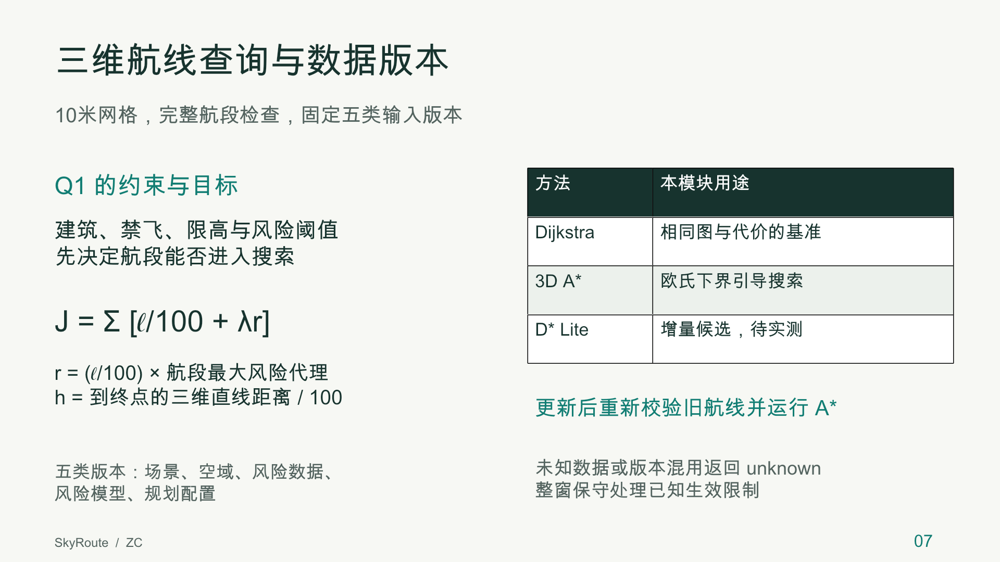
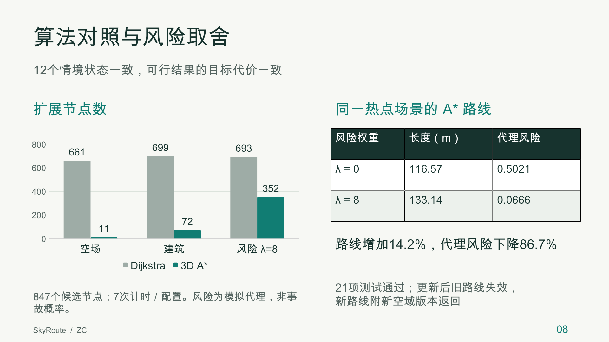

# ZC 展示第7–8页

文件：[两页PPT](zc-routing-evaluation.pptx)。两页均为内容页，合并到小组展示的第7–8页。文字、表格、柱状图可编辑，讲稿和来源同时写入PPT备注。字体为Arial Unicode MS；整合时保留中文完整显示。

## 第7页：三维航线查询与数据版本

主信息：10米网格，完整航段检查，固定五类输入版本。

- 建筑、禁飞、限高与风险阈值先决定航段能否进入搜索。
- 目标 `J=Σ[ℓ/100+λr]`；风险代理 `r=(ℓ/100)×q_max`；A*下界为到终点的三维直线距离除以100。
- Dijkstra负责相同图与代价的基准，3D A*负责当前查询，D* Lite为待实测的增量候选。
- 更新后重新校验旧航线并运行A*；未知数据或版本混用返回unknown。
- 五类版本为场景、空域、风险数据、风险模型、规划配置，空域采用整窗保守处理。

讲述建议：调度员需要知道路线怎样产生、依据哪些数据。我们把每次查询绑定一组固定版本，在三维网格上检查整个航段及2米缓冲。几何和风险硬约束先过滤，允许航段才比较距离和模拟风险。由于风险代价非负，直线距离是可用下界，可以用A*减少无关扩展。当前更新流程重新校验和重新搜索；D* Lite要在变化边可完整定位、拓扑稳定时再比较收益。

来源：[设计正文](../design.md)、[Hart等人的论文](https://ai.stanford.edu/~nilsson/OnlinePubs-Nils/PublishedPapers/astar.pdf)、[D* Lite原论文](https://idm-lab.org/bib/abstracts/papers/aaai02b.pdf)。

## 第8页：算法对照与风险取舍

主信息：12个情境状态一致，可行结果的目标代价一致。

| 情境 | Dijkstra扩展节点 | A*扩展节点 |
| --- | --- | --- |
| 空场 | 661 | 11 |
| 建筑 | 699 | 72 |
| 风险λ=8 | 693 | 352 |

同一热点场景的A*：λ=0时116.57米、风险代理0.5021；λ=8时133.14米、风险代理0.0666。距离增加约14.2%，代理风险下降约86.7%。已通过21项正确性测试，并运行更新后旧路线失效、新路线绑定新空域版本的示例。

讲述建议：同样的输入、约束和目标下，两种算法的可行目标代价一致。建筑场景中两条路线同为116.57米，A*扩展72个节点，Dijkstra扩展699个。风险权重提高后，A*选择更长的绕行，降低模拟风险代理。无解禁飞墙情境下，两者都扩展364个节点，因此收益依赖场景。权重为零时，等长路线的风险可以不同。这里的风险是合成代理，下降比例不能解释为事故率下降。下一步在实际数据与发布实现上测量数据库读取、更新可见延迟和D* Lite总成本。

实验条件：847候选节点，10米网格，26邻居；每配置7次计时，Python 3.15.0 / Darwin arm64。来源：[原始结果](../results/benchmark.json)、[评估说明](../evaluation.md)、[更新实例](../results/update-example.json)。

## 预览

