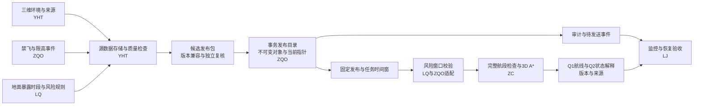
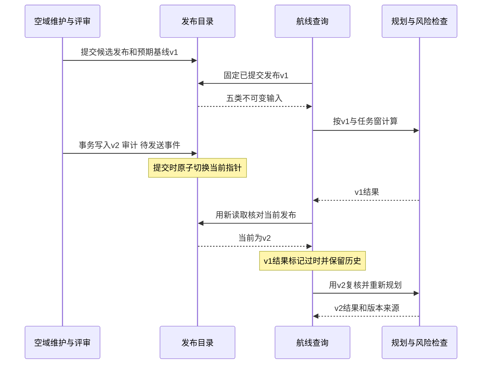

# 总体架构与数据流

## 总体架构

SkyRoute以版本化输入连接数据管理与三维规划。源数据存储承接YHT的数据模型，发布目录控制哪些输入可以组合使用。LQ提供风险规则与治理条件，ZC在完整输入上生成航线，LJ观察服务状态与恢复过程。

图中源存储、身份认证、外部通知和运行监控是总体设计组件。当前可运行组合为ZQO本地事务目录、LQ风险适配器与ZC规划原型。YHT和LJ尚无技术交付，因此采用明确的模拟输入及验收接口。

## 数据发布与查询交错

发布在提交前失败时，目录继续指向v1，未提交对象、审计和通知一起回滚。数据库提交成功但响应丢失时，发布者使用同一请求编号查询或重试即可取得原结果。

## 与报告章节衔接

| 报告内容 | 可直接整合的材料 |
| --- | --- |
| 系统与数据架构 | 本页两张图及五个模块的组件职责 |
| 技术选型与一致性 | design第3至5节的候选比较、事务与查询流程 |
| 数据治理与恢复 | LQ治理章节加ZQO发布审计、LJ实际验收材料 |
| 评估与设计权衡 | evaluation中的事务情境和三模块联合结果 |

图的可编辑源文件见 `figures/architecture.mmd` 与 `figures/publication-sequence.mmd`。
