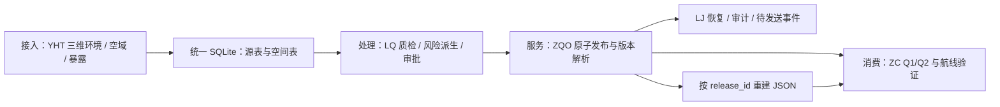
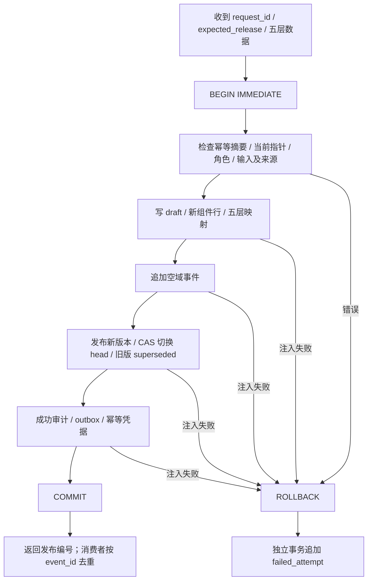
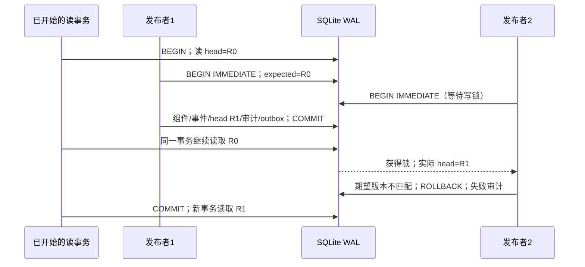

# 架构与事务决定

## 数据管理边界



数据库中的源行、发布清单、五层映射和审计是权威记录。JSON 是固定 `release_id` 的重建结果，可以删除后重新生成。v2 合成实验通过 YHT 的关系表夹具输入，不冒充完整 v1 几何导出器或 LQ 风险编译器。模型与源版本、风险窗口需由真实上游明确填写。

## 操作 B 事务边界



写锁串行化数据库写入，`expected_release` 防止等待锁的旧请求覆盖新发布。持久化成功凭据在检查 head 之前查询；同一请求丢失响应后重试，可返回已经提交的发布。复用请求号但改变内容会被拒绝。失败记录包含候选编号、请求摘要、期望/观察版本和错误；候选版本可能不存在，因此不是外键。

五个回滚注入点分别位于 draft 后、组件后、事件后、head 后、提交前；所有业务表恢复到前态，仅增加失败审计。提交后响应丢失不写失败事务记录。`failed_attempt` 的第二次提交之前若进程死亡，失败审计可能缺失：LJ 需要持久化入口请求日志补齐该恢复窗口。outbox 当前仅提供持久记录和投递状态，消费器采用至少一次投递和 `event_id` 去重；本轮没有实现网络投递。



读事务的 `observed_head` 是该事务看到的 head。调度最终采用航线前应在新事务复核当前 head，否则长读事务看到的“current”不能说明现实中没有更新。此选择保留发布期间的读取能力，代价是读者暂时使用旧版，并可能延缓 WAL checkpoint。[1], [2]

## SQL 与映射

实际 SQL 在 [catalog.py](experiments/catalog.py) 执行；以下省略由绑定参数生成的多行 INSERT，保留提交协议，不能作为独立迁移脚本运行：

```sql
BEGIN IMMEDIATE;
SELECT request_hash, release_id FROM publish_request WHERE request_id=:request;
SELECT release_id FROM current_release WHERE scene_id=:scene; -- 与 expected 比较
-- INSERT release(status='draft'), layer_component, YHT实体行,
-- release_layer, release_component, component_source, airspace_event
UPDATE release SET status='published', published_at=:at WHERE release_id=:new;
UPDATE current_release SET release_id=:new
 WHERE scene_id=:scene AND release_id=:expected; -- rowcount 必须为1；初版 INSERT
UPDATE release SET status='superseded' WHERE release_id=:expected;
-- INSERT audit_event、outbox、publish_request
COMMIT;
```

共享单位是完整图层；一层发生变化就写该层新行。`release_component → layer_component.owner_release_id` 把逻辑查询发布映射到物理行所有者，`release_layer.layer_version` 是规范化内容 SHA-256。空域变更始终写新物理行，让 `airspace_event.release_id` 指向发生这次变更的发布；相同空域在连续发布间仍可共享。历史版本均保留，不进行组件垃圾回收。

定位使用某个组件的发布：

```sql
SELECT release_id, layer FROM release_component
WHERE component_id=:component;
```

`component_dependents(component_id,release_id)` 支持反向查找。源行可经 `component_source` 找到来源组件及发布，再连接其 exposure 组件/模型。LQ 的 `lineage_edge` 用于更细的“哪个源或模型生成哪个派生对象”；ZC 缓存至少以 `release_id` 为键，局部复用另保存依赖组件摘要。新旧组件变更只代表需要重算/复核的候选范围，不能单凭哈希推断某条航线一定失效。

## 新兴技术比较与取舍

| 方案 | 历史与并发机制 | 本项目选择或切换条件 |
| --- | --- | --- |
| 当前 SQLite + 不可变图层映射 | 一个事务提交五层、head、审计；WAL 读快照；历史按 release_id 重建 | 适合当前单库、可复现的小组实验；写锁和图层粒度是扩展限制 |
| Apache Iceberg | 每表快照引用不可变数据文件/元数据；原子替换表元数据并校验并发提交；按版本/时刻查询 | 批量三维资产、对象存储与多计算引擎成为主要负载时评估；仍需独立设计五类数据跨表一致发布 |
| PostgreSQL 18 时态建模 | range + WITHOUT OVERLAPS / PERIOD 表达有效时间约束；系统记录时间用历史表与触发器维护 | 多用户细粒度更新、集中授权与 PostGIS 查询需求提高时评估；需设计有效时间与记录时间，MVCC 本身不等于长期历史库 |

Iceberg 提供快照复用与时间旅行的设计依据[3], [4]；PostgreSQL 的时间范围约束和触发器提供另一种实现路径[5], [6]。后两者为技术比较，未做本机性能排名。

派生数据管理需同时保留来源依赖、模型版本、编译窗口与结果版本。共享图层减少重复存储，但每次发布仍写五条映射和审计，空间不会变为常量。重建 JSON 的成本已测量；风险重新编译、几何构图和局部缓存失效由 LQ/ZC 后续实验测量，不能把导出时间当成全部重建成本。

来源和模型元数据的原地修改目前能绕过其他表组的历史约束；读取时会检测摘要漂移并报错。问题 YHT-V2-05/06、LQ-V2-01 的修复要求见 [issues.md](https://github.com/zoran-sid/Routeweave/blob/develop/docs/integration/issues.md)，这是当前直接 SQL 写入与历史可用性的实际缺口。
