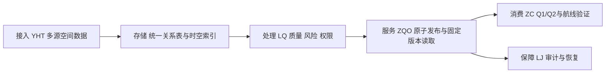
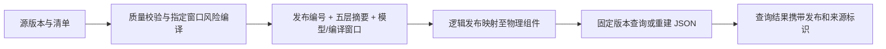

# ZQO 章节稿

## 摘要初稿

城市三维环境、动态空域与风险数据持续变化时，航线服务如何读取一致、可追溯的数据？SkyRoute 将五类输入绑定为不可变发布，以统一关系模式、时空索引、原子切换和来源映射支持规划与复核。本轮基于 SQLite 验证并发发布、更新可见性、失败回滚和历史重建。在每版仅改变空域的合成负载下，1000版组件共享较全量复制减少约81.7%的数据库空间，抽样历史导出内容一致。风险治理、查询负载及恢复结论由后续章节的独立实验补齐。

## 1 问题、用户与范围

项目研究多源数据更新下的一致性发布、时空检索和来源追溯。建筑更新、临时禁飞和暴露信息变化若被分批读取，航线可能混用不同时间的数据。我们先确定“这次查询用了哪一版”，再验证航线在该版本与任务窗口内是否可行。

| 用户 | 需要的结果 | 数据管理价值 |
| --- | --- | --- |
| 物流调度员 | 查询可行路线并确认当前版本 | 避免采用已被新限制影响的旧结果 |
| 无人机运营人员 | 查看限制、风险依据与数据质量 | 识别未知数据和需要复核的区域 |
| 空域及安全管理员 | 发布、撤销限制并追溯影响 | 保留变更责任、事件顺序与历史状态 |
| 系统管理人员 | 审计、恢复及版本核验 | 故障后确认数据与发布清单一致 |

场景采用模拟城市片区、局部米制坐标和 UTC 半开时间窗。三类业务数据组织成场景、地形、空域、暴露、来源五层；规划作为输入可靠性的应用验证。问题与用户对应《作业要求.pdf》第1–2页，范围与实验覆盖对应第6页。[7]

## 3.1 总体架构

源数据、版本清单和审计以数据库为准；JSON 按发布编号重建。架构分层与取舍对应课程第2页，具体边界见 [架构说明](architecture.md)。[7]

## 3.2 数据流与版本边界

源版本与查询层版本分别保存：前者说明上游交付，后者以内容摘要标识实际关系行。发布同时记录源清单、风险模型、编译器与编译窗口；窗口不匹配拒绝发布。LQ/ZC 后续以这些标识连接派生风险和航段来源。

## 5 事务、版本与派生数据管理

### 5.1 发布与撤销

操作 B 在 `BEGIN IMMEDIATE` 中校验请求、预期 head 与五层输入，写组件、空域事件、当前指针、成功审计和 outbox 后提交。写锁串行化发布，预期版本比较拒绝等待期间过时的请求；幂等凭据处理提交成功但响应丢失。[1], [2]

撤销创建新的空域组件，旧版保留原限制；查询先固定发布，再解析其组件所有者。WAL 读事务可继续读旧快照，新事务看到完整新版。调度采用结果前需重新核对 head，兼顾读取可用性与更新时效。[1]

### 5.2 可复核证据

| 实测场景 | 结果 |
| --- | --- |
| 两连接竞争同一旧 head | 一次成功、一次版本冲突，保留失败审计 |
| 写入未提交及提交后的旧读事务 | 均看到旧版；结束读事务后看到新版 |
| 五处注入失败 | 业务表与 head 回滚，仅新增失败记录 |
| 提交后丢响应并重试 | 返回同一发布，不重复产生事件 |
| 撤销、历史重开 | 新版撤销，旧版内容与来源保持一致 |

存储实验使用25栋建筑、121个地形点、3个限制和6个暴露区，每版仅改变一个限制高度；Python 3.13.15、SQLite 3.50.4、macOS arm64，WAL/FULL。全量组每版复制空间行；两组共用来源、角色、模型登记表。checkpoint 后测数据库文件，包含索引和审计；历史读取含 SQL、摘要核验和 JSON 序列化，热文件缓存下每档30次。

| 发布数 | 共享 / 全量空间 MiB | 历史重建中位数：共享 / 全量 ms |
| --- | --- | --- |
| 10 | 0.38 / 0.63 | 1.032 / 1.053 |
| 100 | 0.90 / 3.58 | 1.040 / 1.057 |
| 1000 | 6.20 / 33.91 | 1.040 / 1.069 |

1000版共享节省约81.7%空间，抽样导出摘要相同；本实验支持存储收益，未显示明显读取收益。原始记录见 [实验结果](experiments/results/transactions-storage.json)，方法对应课程第6页评价要求。[7]

### 5.3 数据血缘与版本化派生数据

组件反向索引定位依赖某版输入的发布；源清单、模型版本与编译窗口进一步解释风险结果如何产生。输入变化后，先标记依赖的派生数据，再重建风险或查询缓存。共享单位为图层，一处修改仍重写整层；JSON 重建成本已测量，风险编译及构图成本交 LQ/ZC 测量。这落实课程第4页元数据与血缘的新兴技术讨论。[7]

| 选择 | 适用条件与取舍 |
| --- | --- |
| SQLite 不可变组件共享 | 当前单库规模下，一次事务绑定五层；减少重复行，增加映射解析；写入仍串行 |
| Apache Iceberg 快照/时间旅行 | 大型批量资产、对象存储和多引擎分析时评估；快照复用与原子元数据提交可借鉴，跨表一致发布需另设计[3], [4] |
| PostgreSQL 18 时态建模 | 多用户写入、集中权限和复杂空间查询时评估；range、时态约束配合历史表/触发器记录有效时间与系统时间[5], [6] |

当前来源/模型元数据存在直接 SQL 修改缺口，读取会检测摘要漂移并报错；已交 YHT/LQ 修复。失败回滚后、失败审计提交前的进程崩溃窗口交 LJ 验证。具体问题与接口见 [对接说明](integration.md)，课程报告结构对应第4–5页。[7]
