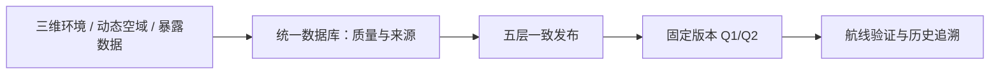
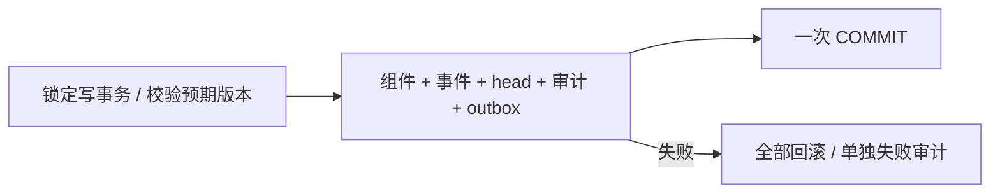

# ZQO v2 展示稿：建议2页

交由 ZC 按全组模板排版。采用“结论标题 → 图示/证据 → 条件 → 来源”结构；术语沿用 YHT 的五层版本与半开时间窗。展示以数据库设计为主。

## 第1页：每次航线查询，都应知道自己用了哪一版数据

**核心问题**：建筑、空域限制与风险信息持续变化，如何让查询读到一致、可追溯的数据？

主图：

| 谁使用 | 获得什么 |
| --- | --- |
| 调度员 / 运营人员 | 可靠的路线输入、限制与质量依据 |
| 空域及安全管理员 | 可追溯的发布与撤销 |
| 系统管理员 | 可恢复的发布、审计与版本证据 |

页脚：模拟城市片区；数据库为准，JSON 可重建。课程《作业要求.pdf》第1–2页；资料[7]。

**讲稿（约45秒）**：我们把核心问题放在数据管理上。限制刚刚更新时，系统不能一边读取新版空域，一边无意中使用另一版风险信息。SkyRoute 为一次查询固定发布编号，绑定场景、地形、空域、暴露和来源五层。调度人员获得可核验的输入，管理员能追溯变更，系统恢复时也有明确的核对依据。后续航线算法负责验证这些输入是否支持可行路线。

## 第2页：原子发布保持一致，组件共享减少历史存储

左侧机制图：

右侧两组证据：

| 正确性实验 | 实测 |
| --- | --- |
| 两发布者竞争 | 1成功 + 1版本冲突 |
| 5处注入故障 | 5处均回滚；失败可追溯 |
| 旧读事务 / 新读事务 | 旧版一致 / 新版完整 |
| 响应丢失重试 | 同一发布；无重复事件 |

| 1000版历史 | 全量空间行复制 | 组件共享 |
| --- | --- | --- |
| 数据库 | 33.91 MiB | **6.20 MiB（减少81.7%）** |
| 历史重建中位数 | 1.069 ms | 1.040 ms |

条件：25栋建筑、121地形点、3限制、6暴露区；仅空域逐版变化；SQLite 3.50.4、WAL/FULL；历史读取热文件缓存、每档30次。计入索引/审计，源与模型登记表两组共用。完整10/100/1000版结果见[实测记录](experiments/results/transactions-storage.json)。

**设计取舍**：发布期间继续读旧快照；采用路线前重新核对版本。共享节省存储，图层更新仍有重写成本。数据血缘指导派生缓存失效，Iceberg / PostgreSQL 为规模与并发增长后的比较方案。

页脚：资料[1]–[6]；课程第2页架构取舍、第4页新兴技术、第6页评价。

**讲稿（约60秒）**：这页展示两个选择。第一，组件、指针、事件和成功审计在同一事务提交，因此读者看不到半次发布。两个请求竞争时只有一个能基于原版本成功，另一个明确返回冲突。第二，历史版复用不变的图层。我们的1000版实验把数据库空间从33.91降到6.20 MiB，历史导出内容一致，读取时间都约1.1毫秒。收益主要来自减少重复空间行。对实时调度来说，旧快照可读不等于仍可采用，所以提交路线前还要复核当前版本。

**答疑备注**：图中是已验证的发布模块。全组 v2 风险治理、查询缓存与灾备随后接入；来源/模型直接 SQL 修改缺口已有问题单，导出遇到漂移会报错。不要把 v1 完整链路通过表述为 v2 已全部完成。
