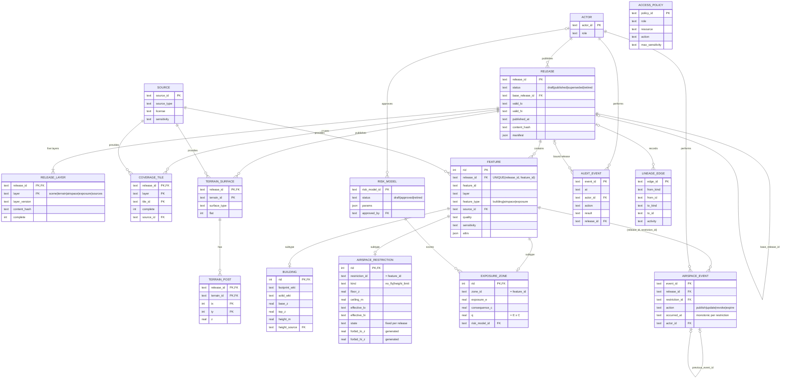
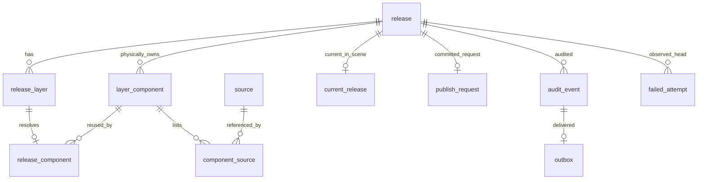
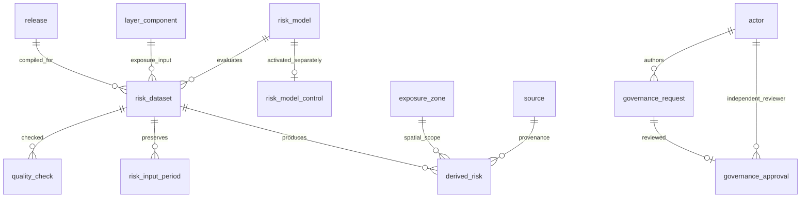
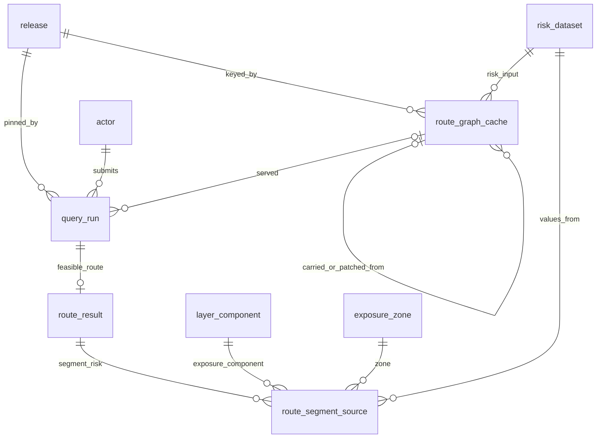

# SkyRoute v2 统一模式 ER 图

逻辑模型见 [YHT 数据字典](../../modules/yht/v2/data-dictionary.md)；可执行 DDL 见 [schema.sql](schema.sql)；设计取舍见 [decisions.md](decisions.md)。

## 表用途、时间字段与版本关系

| 表 | 用途 | 时间字段 | 版本关系 | 负责人 |
| --- | --- | --- | --- | --- |
| `release` | 一次不可变发布 | `valid_lo/hi`、`created_at`、`published_at`、`retired_at` | 版本根；`base_release_id` 指向父发布 | ZQO 细化 |
| `release_layer` | 五层内容版本与哈希 | `generated_at` | 发布前五层必须齐全 | ZQO 细化 |
| `coverage_tile` | 每层覆盖完整性 | `valid_lo/hi` | 随发布；主键含 `release_id`、`layer` | YHT |
| `feature` | 建筑、空域、暴露的公共头 | `valid_lo/hi`、`recorded_at` | 随发布；`feature_id` 跨发布稳定 | YHT |
| `building` | 建筑三维体 | — | 随 `feature` | YHT |
| `terrain_surface`、`terrain_post` | 地形面与格网点 | `valid_lo/hi` | 随发布；主键含 `release_id` | YHT |
| `airspace_restriction` | 禁飞或限高体 | `effective_lo/hi`、`published_at`、`revoked_at` | 状态随发布固定；撤销写新发布 | YHT，ZQO 细化事务 |
| `airspace_event` | 发布、更新、撤销、到期事件 | `occurred_at`、`effective_at` | 只追加；指向所属发布中的限制 | ZQO 细化 |
| `exposure_zone` | 地面暴露分区与 E/C/q | `valid_lo/hi` | 随发布；引用风险模型版本 | YHT，LQ 细化 |
| `risk_model` | 风险模型版本 | `valid_lo/hi` | 独立于五层；只有 `approved` 可用 | LQ |
| `source` | 来源、许可、精度 | `acquired_at`、`valid_lo/hi` | 长期；被发布引用 | YHT |
| `actor`、`access_policy` | 操作者与访问策略 | `created_at` | 策略按状态版本化 | LQ |
| `lineage_edge` | 对象级血缘 | `at` | 可绑定发布 | LQ |
| `audit_event` | 操作与查询审计 | `at` | 只追加；可绑定发布 | LQ |

R*Tree 虚表（`rtree_building`、`rtree_airspace`、`rtree_exposure`）是派生索引，由触发器维护，可以从基表重建，不出现在 ER 图中。

## ZQO 发布扩展（v2 第2棒）

`failed_attempt.observed_release_id` 可空；候选编号仅为文本，可指向从未提交的发布。历史发布与组件不得删除。完整字段见 schema.sql 第2节；逻辑发布和物理 owner 的查询区别见 [ZQO 接口](../../modules/zqo/v2/integration.md)。

## LQ 治理扩展（v2 第3棒）

`risk_dataset`的window_lo/hi必须等于绑定release窗口，component_id必须解析到同次逻辑发布的exposure层；zone_rid引用物理owner行。时段输入及结果按dataset_id留存，封存后不可变。`risk_model_control`保存enabled/操作者/时间/原因，不改历史模型语义。`quality_check`按checked_at追加。

`governance_request`保存作者和候选内容摘要；审批保存reviewer/decision/at。数据库拒绝作者自审，发布网关核对已批准摘要后调用ZQO事务。lineage_edge新增component/dataset端点，存在性和dataset依赖由触发器校验。现有23实体加7个LQ实体共30个；ZC 正式查询表见下节。

## ZC 查询与结果追溯（v2 第4棒）

| 表 | 用途 | 时间字段 | 版本关系 | 负责人 |
| --- | --- | --- | --- | --- |
| `query_run` | 一次 Q1：发布、提交者、任务窗口、起终点、配置、取数路径、状态 | `requested_at`、`window_lo/hi` | 绑定逻辑发布；`freshness` 由触发器按当前指针判定 | ZC |
| `route_result` | 可行航线的度量与航点 | — | 随 `query_run`，只追加 | ZC |
| `route_segment_source` | 航段的风险来源（LQ 操作 C 合同） | — | 组件、分区、数据集须属于查询发布，数据集窗口覆盖任务窗口 | ZC |
| `route_graph_cache` | 派生图元数据：发布、数据集、搜索域、窗口、配置、内容摘要、来源方式 | `window_lo/hi`、`created_at` | 按发布记账；`carried`/`patched` 指向上一发布同键图 | ZC |

现有30个实体加4个 ZC 实体共34个；`test_schema` 实体清单同步更新。图本体保存在规划服务内存，以 `payload_hash` 索引，可由发布重建。
